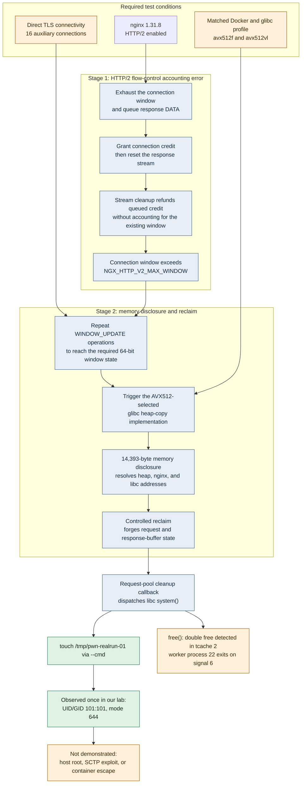
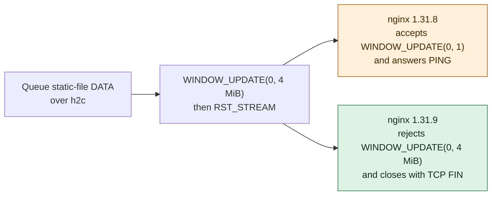

# `CVE-2026-123007`: demonstrated HTTP/2 attack chain

The diagram separates the compact accounting test from the full Rapid7 RCE chain, reproduced once (2026-11-21) in a disposable nginx:1.31.8 container I own, driven from a python:3.10 container on the isolated AVX512 host. The command ran as the nginx worker inside the container. It did not establish host root or container escape.

## Compact accounting test

The separate 5.69 MB h2c test stops after demonstrating the over-credit window. It does not perform memory corruption or command execution.

Evidence: [`REPORT.md`](../evidence/cve-2026-123007/REPORT.md), [`RCE-CONFIRMED.md`](../evidence/cve-2026-123007/RCE-CONFIRMED.md), and [`rapid7-rce-marker.txt`](../evidence/cve-2026-123007/rapid7-rce-marker.txt). These record the single genuine RCE run on 2026-11-21 against our own nginx:1.31.8 container (auto-selected profile `golden-nginx-1.31.8-debian13-amd64`): the `/tmp/pwn-realrun-01` marker (UID/GID 101:101, mode 644) and the worker crash on signal 6. The full client log is retained in the source investigation.
